# BAPS e-Library

## System Title and Group Information

**System Name:** Book Access and Processing System (BAPS) e-Library

**Librarians and roles:**

- Prof. Nico Barlizo — Chief Librarian
- Prof. Mark Justine Almario — Librarian
- Prof. Juan Miguel Saligumba — Librarian
- Prof. Byron Pajac — Librarian

## 1. System Overview / Description

BAPS e-Library is a web-based library management system for students and librarians. Students can browse and search the book catalog, save favorites, request books, track loans and due dates, and review borrowing history and late penalties. Librarians manage the book inventory and student accounts, approve or reject borrowing requests, confirm returns, and review circulation and overdue reports. The system uses separate student and librarian interfaces to support these workflows.

## 2. List of Features

- Student registration and login using a username or student ID.
- Role-based student and librarian dashboards.
- Book catalog search, category filtering, availability filtering, and book details.
- Student favorites, borrowing requests, request cancellation, and return requests.
- Librarian book inventory and student account management (create, view, update, and delete).
- Librarian approval or rejection of requests and confirmation of returned books.
- Borrowing history, book ratings, notifications, overdue tracking, and penalty summaries.
- Library reports with date filters, popular books, category stock, and overdue information.
- Profile, profile-picture, and password management.

## 3. Graphical User Interface

Screenshots are stored in `docs/screenshots/`.

### Figure 1. Home / Landing Page

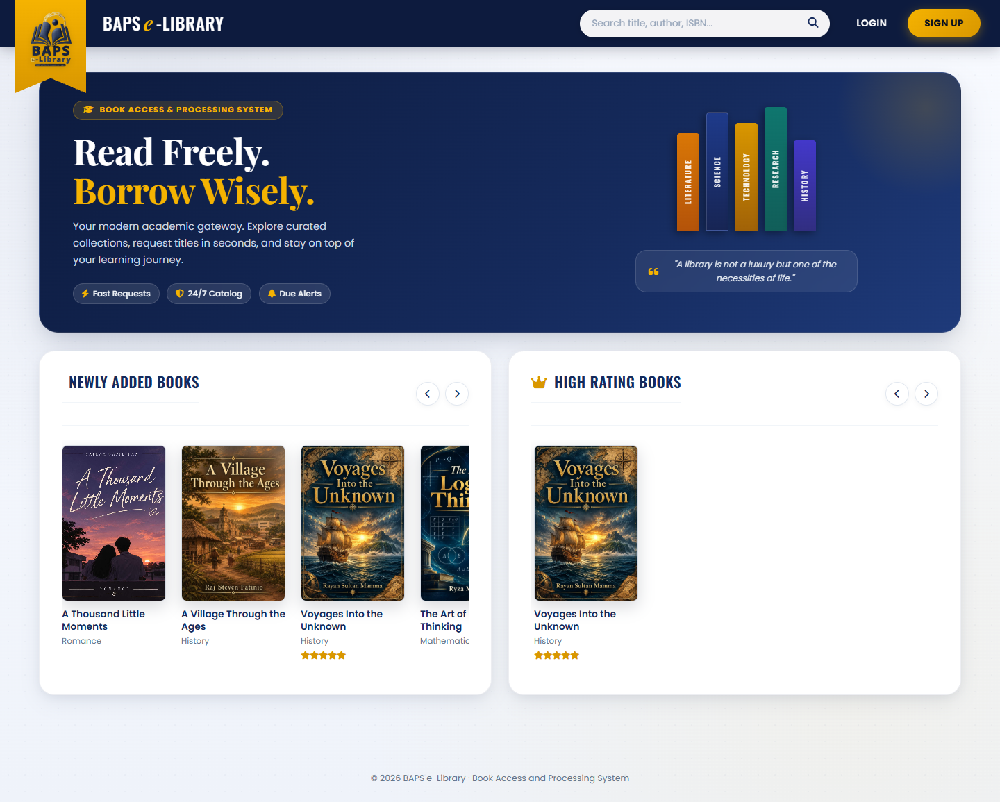

The home page introduces the library and displays newly added and top-rated books. Visitors can search the catalog; signed-in users are redirected to their dashboard.

### Figure 2. Login Form

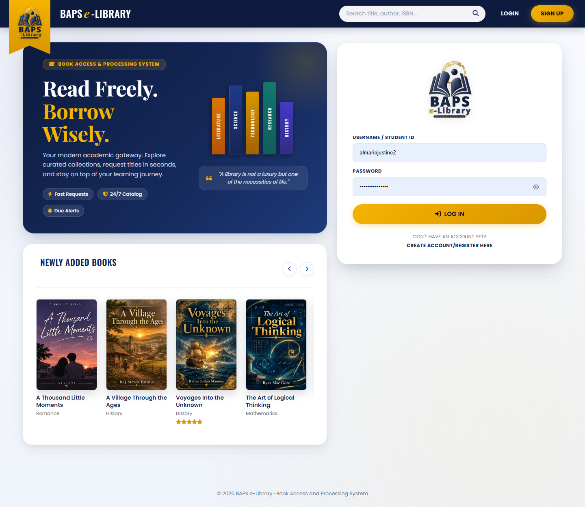

Students and librarians enter a username or student ID and password. Successful login opens the appropriate role-based area.

### Figure 3. Student Registration

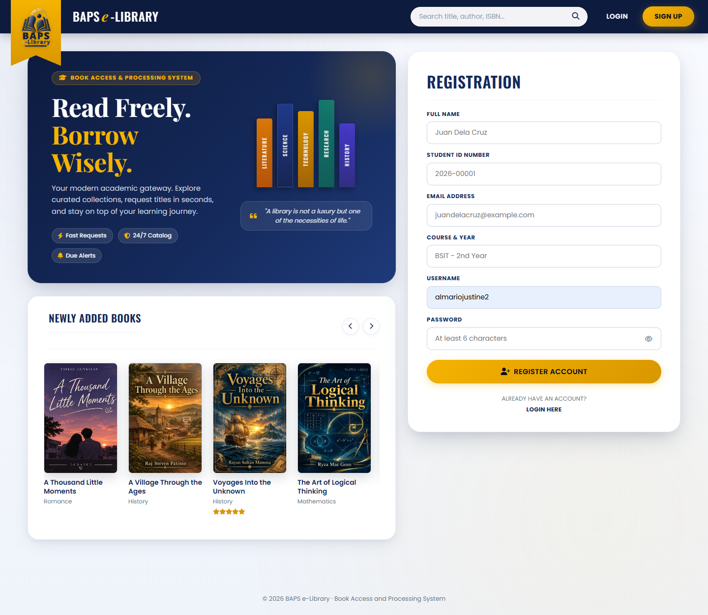

A student provides their name, student ID, email, course and year, username, and password to create an account.

### Figure 4. Student Dashboard

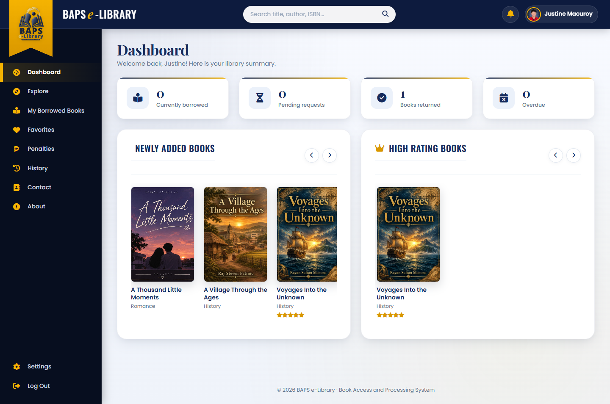

The dashboard summarizes current loans, pending requests, returned books, and overdue books, and shows book recommendations and due dates.

### Figure 5. Explore Books

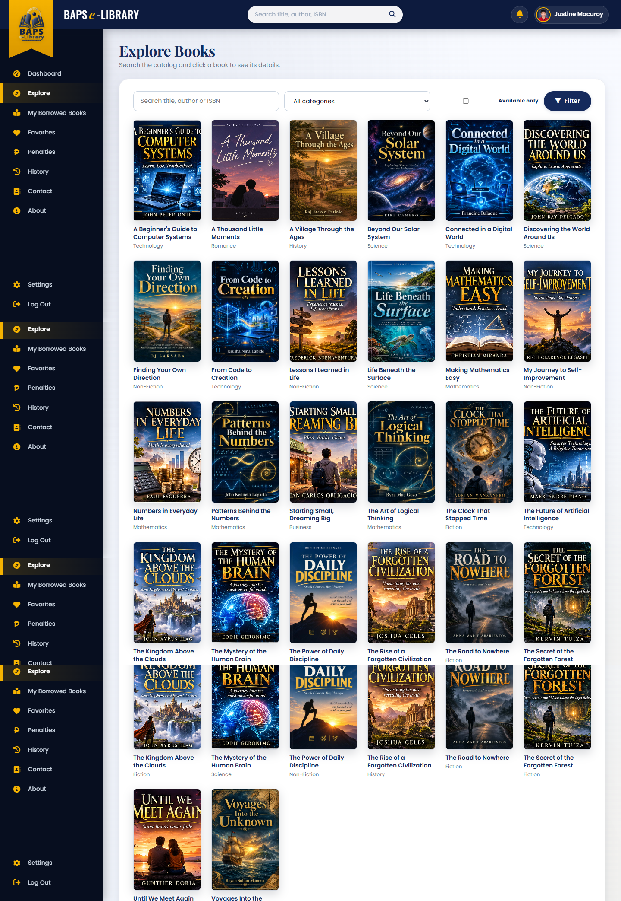

Students can search by title, author, or ISBN; filter by category or availability; and open a book to see its details or request it.

### Figure 6. My Borrowed Books

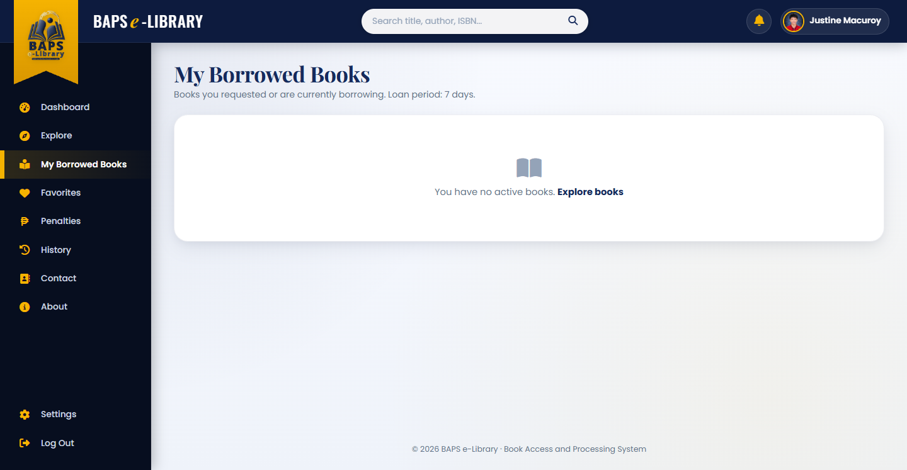

This page lists pending requests, borrowed books, due dates, and return status. Students can cancel a pending request or ask to return a borrowed book.

### Figure 7. Student Favorites

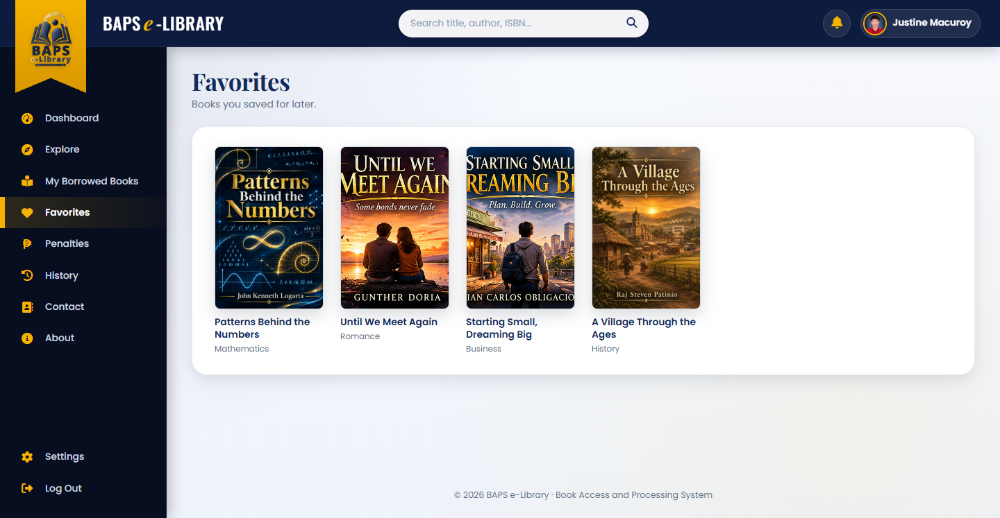

Students can save books to this page to find them again later.

### Figure 8. Borrowing History

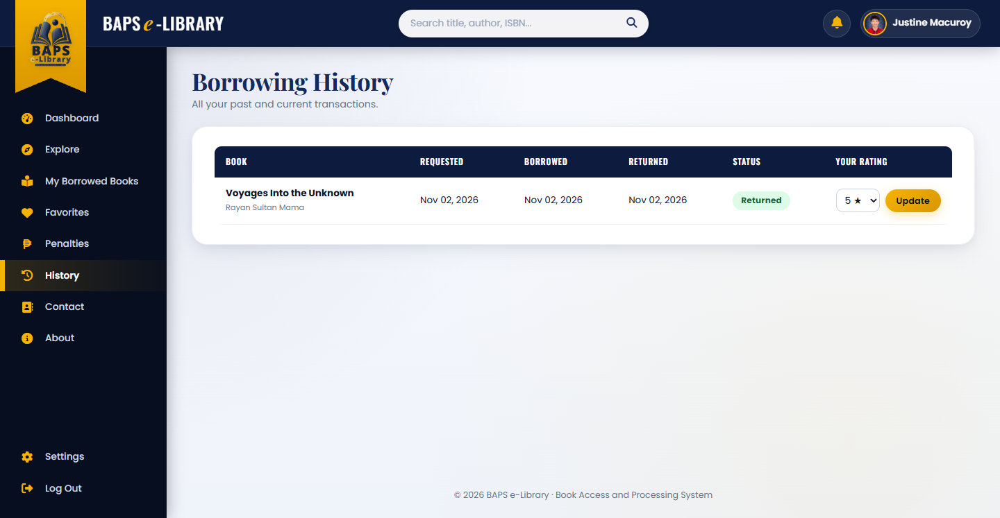

The history page shows past and current transactions, including requested, borrowed, and returned dates. Students can rate books they have returned.

### Figure 9. Student Penalties

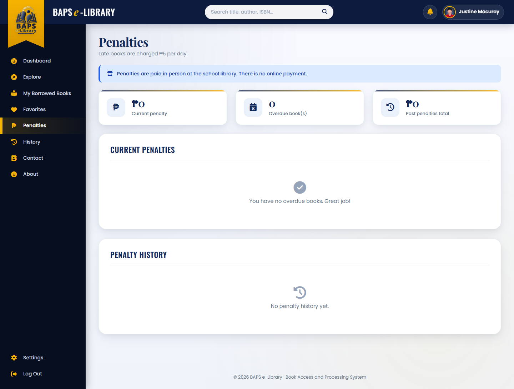

Students can review current overdue books, daily penalties, and their past penalty history.

### Figure 10. Librarian Dashboard

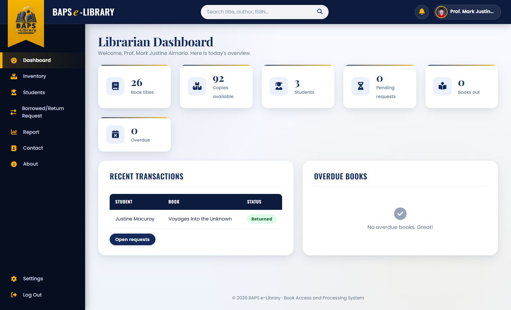

The dashboard shows book and student totals, available copies, pending requests, active loans, overdue books, and recent transactions.

### Figure 11. Book Inventory

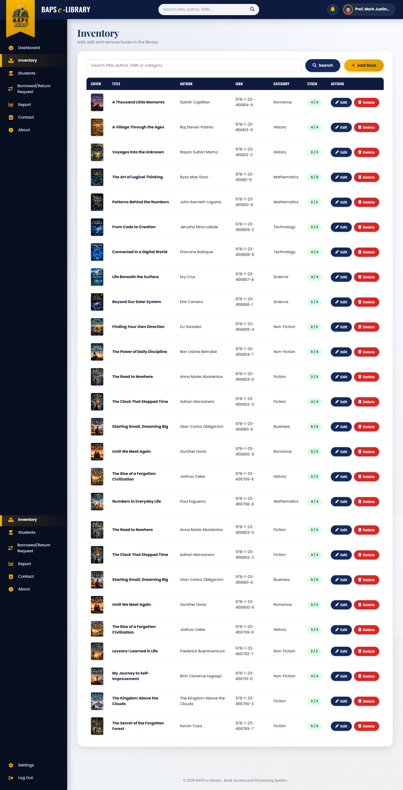

Librarians can search, add, edit, or remove books and view total and available copies.

### Figure 12. Student Management

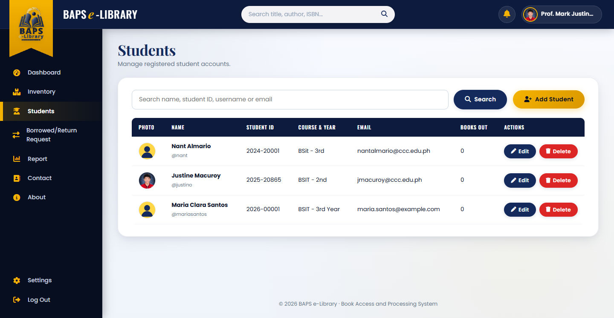

Librarians can search student accounts, register students, update their information, and remove accounts that have no active loans or requests.

### Figure 13. Borrow and Return Requests

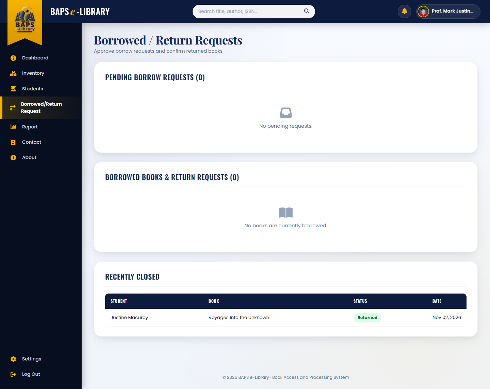

Librarians approve or reject pending requests, confirm returned books, and review recently closed transactions.

## 4. Technology

- **Backend:** PHP
- **Database:** MySQL / MariaDB, accessed through PHP `mysqli`
- **Frontend:** HTML, CSS, and JavaScript
- **Local development environment:** XAMPP (Apache and MySQL)

## 5. Installation and Setup

### Requirements

- XAMPP with Apache, MySQL/MariaDB, and PHP enabled.
- A web browser.

### Steps

1. Copy or clone this project into the XAMPP web root, for example `C:\xampp\htdocs\WDP`.
2. Start **Apache** and **MySQL** from the XAMPP Control Panel.
3. Open phpMyAdmin at `http://localhost/phpmyadmin`.
4. Import `database/baps_elibrary.sql`. The dump creates the `baps_elibrary` database and its tables and sample book records.
5. Check the database settings in `config/db.php`. The default configuration expects host `localhost`, user `root`, an empty password, and database `baps_elibrary`; adjust these values if your local MySQL setup differs.
6. Visit `http://localhost/WDP/` in your browser.
7. Register a student account from the login page, or sign in with a librarian account provisioned for your installation.

When the database has no librarian accounts, the application seeds four default librarian accounts on its first database connection. Change any default credentials before using the system outside a local development environment.

## 6. Main Project Structure

```text
WDP/
├── assets/
│   ├── css/                 # Application styles
│   ├── images/              # Logos, default images, and librarian photos
│   └── js/                  # Browser-side interactions
├── config/
│   └── db.php               # MySQL connection and session setup
├── database/
│   └── baps_elibrary.sql    # Database schema and sample data
├── includes/
│   ├── functions.php        # Shared helpers and library rules
│   ├── layout.php           # Shared page layout
│   └── public_parts.php     # Shared book and home-page components
├── librarian/               # Librarian dashboard and management pages
├── student/                 # Student catalog and account pages
├── uploads/                 # Uploaded book covers and profile pictures
├── index.php                # Home page
├── login.php                # Sign-in page
└── register.php             # Student registration
```

## 7. Borrowing Rules

- A student can have up to five different books borrowed or requested at a time, with one copy per title.
- Students with overdue books cannot submit new borrowing requests until the overdue books are returned.
- A librarian must approve a borrowing request. The loan period is seven days from approval.
- Late returns accrue a penalty of PHP 5 per day. Penalties are paid in person at the school library; the application does not process online payments.
- Students may rate a book from one to five stars after it has been returned.

## 8. Notes

- Uploaded book covers and profile pictures are stored under `uploads/`.
- The default database connection settings are intended for local XAMPP development. Configure suitable credentials and secure the application before deploying it to a shared or production server.
